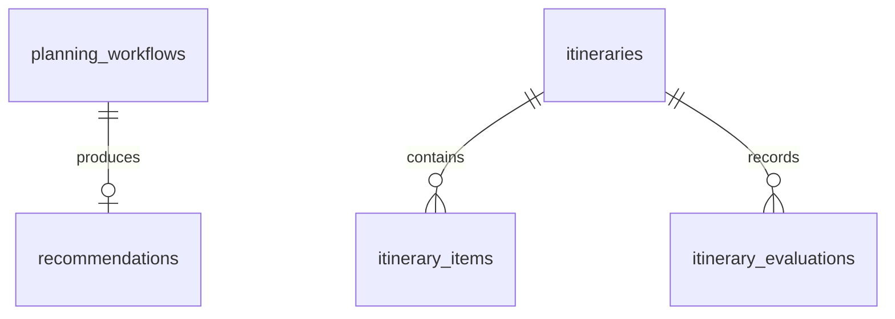

# Schema Design Status

Auth, Coastal Planner, Marine Safety and Experience & Biodiversity have
PostgreSQL/EF Core schemas with checked-in migrations under their owning
service directories. Coastal Operations and shared Agentic AI workflow-state
tables remain deferred; shared G00 data-ownership and integrated component
acceptance remain pending.

The Auth schema contains users, roles, permissions, device installations,
active sessions, session lifecycle logs, rotating refresh-token records and the
two many-to-many assignment tables. It includes unique email/name/code
constraints, one active session row per user/device pair, session-version
state, absolute expiration, foreign-key cascade behavior, token-version
revocation state, system-role protection and `CreatedAt`/`UpdatedAt` fields
where applicable. Auth enforces a maximum of five active account sessions for
one installation and five active sessions per account across installations.

## Experience & Biodiversity connection foundation

Experience & Biodiversity connects to the same PostgreSQL database and with
the same configured login as Auth. Its EF Core context uses PostgreSQL's
default `public` schema; its migrations are tracked in
`__EFMigrationsHistory_ExperienceBiodiversity` in that same schema. No second
database, service-specific login or SQL provisioning file is used. The Member
1 feature branch includes an initial migration
(`20260927113951_InitialExperienceBiodiversitySchema`) for these tables:

| Table | Current purpose |
|---|---|
| `destinations` | Coastal destination identity, location, publication status and audit timestamps. |
| `activities` | Activity taxonomy identity, category, publication status and audit timestamps. |
| `offerings` | Destination/activity-linked experience details, pricing, capacity and publication status. |
| `schedules` | Offering schedule intervals, time-zone identifiers and active state. |
| `favourites` | User-scoped saved destination, activity or offering references; user IDs remain opaque Auth UUIDs. |

This branch schema is implementation evidence, not acceptance of the shared
G00 data-ownership or migration-history contract. The other member domains and
shared Agentic AI workflow-state schema remain future work.

## Auth session tables

Bootstrap permission identity is the unique permission code. Preferred seed
GUIDs are used only when free; if another member's existing code occupies one,
Auth allocates a new GUID for the missing code. Existing identities, descriptions,
role assignments and audit timestamps are preserved, and repeated seeding is
idempotent. This is an essential member-integration correction for reused Marine/
Experiences seed IDs, with no schema or authentication-flow change.

| Table | Important fields and constraints |
|---|---|
| `DeviceInstallations` | Server-issued `DeviceId` primary key, hashed `DeviceKeyHash`, legacy marker, last-seen and revocation timestamps. The device key is never stored in plaintext. |
| `ActiveSessions` | Only currently active session rows; unique `(UserId, DeviceId)`, JWT `SessionVersion`, `CreatedAt`, `LastSeenAt`, absolute `ExpiresAt`, `RememberMe` and a foreign key to the installation. |
| `UserSessionLogs` | Append-only ended-session records with the original lifecycle fields, `EndedAt` and bounded `EndReason`; never used for authentication. |
| `RefreshTokens` | Unique SHA-256 token hash, session/family IDs, issued and expiry timestamps, consumed/revoked timestamps, replacement link and revocation reason. Each row references exactly one active session or session log. Raw refresh tokens are never persisted. |

`20260921033902_AuthSessionLifecycle` backfills legacy device-installation
rows from existing `UserSessions` before adding the installation foreign key
and gives pre-existing sessions a one-day migration expiration.

`20260921133008_ActiveSessionsAndSessionLogs` separates active and ended
sessions without losing history. Existing valid rows are moved to
`ActiveSessions`; revoked or expired rows are moved to `UserSessionLogs`; and
refresh-token references are transferred to the corresponding log rows when a
session is archived.

## Coastal Planner tables

`services/coastal-planner/Data/Migrations` owns the `coastal_planner` schema.
Actor IDs are stored as opaque UUID references; the planner does not add
cross-service foreign keys to Auth or other components.

| Table | Important fields and constraints |
|---|---|
| `planning_workflows` | Workflow ID, actor ID, type, status and lifecycle timestamps; indexes on actor, status and creation time; status check limits values to `PENDING`, `PROCESSING`, `COMPLETED` and `FAILED`. |
| `recommendations` | Unique workflow ID, owner ID, destination, UTC window, duration, candidate snapshot and uncertainty-note snapshot; checks enforce a positive window and duration; indexed by owner. |
| `itineraries` | Owner ID, title, optional description, UTC window, optimistic `ConcurrencyVersion`, and created/updated timestamps; check enforces end after start; indexed by owner and creation time. |
| `itinerary_items` | Ordered destination/activity/offering reference, UTC schedule, last known availability/suitability/operations states, and advisory; cascades from its itinerary; unique `(ItineraryId, OrderIndex)` and checks enforce a non-negative order and positive schedule interval. New items begin as `UNKNOWN`. |
| `biodiversity_predictions_cache` | Destination/activity, validated provider and model/version, prediction timestamp, expiration, prediction snapshot, uncertainty text and limitations; indexed by destination/activity/model version. Cache lookup requires the configured expected model version; TTL is six hours pending provider approval. |
| `itinerary_evaluations` | Evaluation ID, owning itinerary ID, UTC review time and structured result snapshot with previous/current evidence; indexed by itinerary/time; cascades from its itinerary. |

`20261005163837_ItineraryReviewHistory` adds itinerary/item `TimeZone`
columns, recommendation `Outcome` and the review table. Legacy rows retain
their IDs, ownership, versions and UTC times; their display zone defaults to
`Asia/Colombo` and legacy recommendation outcomes remain `LEGACY_RESULT`.
New search outcomes distinguish matches, no matches and unavailable evidence.
Itinerary edits and reviews increment the optimistic version. Reorder updates
use unused temporary orders in a transaction before applying final orders.

The workflow owns at most one recommendation result. Itinerary reads and
mutations are scoped by `OwnerUserId`; recommendation and workflow reads are
scoped by their owner/initiator IDs. Cached predictions expire six hours after
the source inference timestamp and are never synthesized when the ML endpoint
is unavailable.

The eventual schema documentation must include:

- ER diagram
- table definitions
- keys
- relationships
- constraints
- indexes
- audit fields
- migration strategy
- seed data
- Agentic AI workflow-state tables, if required

The v1 target schema must support four member-owned domains:

- Coastal experiences: destinations, activities, offerings, schedules,
  statuses, favourites and relevant biodiversity context.
- Marine conditions and safety: sourced snapshots, freshness, activity
  safety profiles and deterministic suitability results.
- Coastal planning: recommendation workflows and result snapshots,
  itineraries and ordered items (implemented in the Coastal Planner feature
  branch; cross-component acceptance is still pending).
- Coastal operations: assessments, proposals, operational state, approval
  decisions, advisories, alerts and execution history.

Shared structured Agentic AI workflow state must retain only the objective,
plan, steps, outputs or auditable summaries, validation, errors, bounded
retries, approvals, result and timestamps required to operate and audit the
workflow. Do not store hidden reasoning, passwords, bearer tokens or
unnecessary sensitive data. The remaining member-owned schemas still require
their own migrations. Feature-branch implementation is not evidence of shared
G00/G07 acceptance or merged deployment.

See the [v1 component and agent index](../v1/README.md). Business-domain
schema should be introduced with its owning implementation rather than
prematurely in the v0 foundation.

## Planner provider evidence — 2026-10-12

The opt-in `PLANNER-POSTGRES-001` check passed against the local DHI PostgreSQL
16 container. It upgraded a legacy itinerary, applied pending migrations,
preserved ownership/title/version, reordered stable item IDs under the unique
index, rejected stale writes and invalid constraints, and checked review/item
cascade deletion. The runner created and dropped only its uniquely named test
database. No application volume reset or production database access occurred.
## Marine conditions and safety tables (implemented)

The marine-safety component service
(`services/marine-safety`, migrations `InitialMarineSafetySchema` and
`SafetyProfileReviewAndAssessmentEvidence`) owns the first v1 domain tables in
the shared `blueverse` database:

| Table | Keys, constraints and purpose |
|---|---|
| `MarineActivities` | `Id` PK, nonunique indexed `Name`, `ActivityType` (100 characters), `IsActive`, audit timestamps. Non-authoritative projection of Member 1 published activities. Legacy rows retain historic references; current availability is always checked through the catalogue, never this table. |
| `SafetyProfiles` | `Id` PK, `ActivityId` FK → `MarineActivities` (cascade), positive-limit CHECK constraints (`MaxWindSpeed`/`MaxWaveHeight`/`MaxSwellHeight` > 0), caution-band CHECKs (each optional `Caution*` < its hard limit), partial unique index enforcing one active profile per activity, unique `(ActivityId, Version)`, per-factor source and rationale, author/reviewer IDs and review/effective timestamps. Drafts are inactive; approval is required before evaluation can use a version. |
| `ConditionSnapshots` | `Id` PK, `Latitude numeric(8,5)`/`Longitude numeric(9,5)`, `ForecastTime`/`RetrievedAt` timestamptz, nullable environmental values (`WindSpeed`, `WaveHeight`, `SwellHeight`, `Rain`, `WeatherCode` — null means unavailable, never zero), `Source`, `FreshnessStatus`, `MissingFields text[]`; location/forecast and retrieval indexes. Provider-derived and immutable through the public API. |
| `SuitabilityAssessments` | `Id` PK, `ActivityId` FK (restrict), captured activity name, profile/snapshot IDs and version, request/forecast/evaluation times, `Result` (`SUITABLE`/`CAUTION`/`UNSUITABLE`/`UNKNOWN`), violations/caution/missing arrays, copied condition values and retrieval metadata, copied limits and per-factor criteria citations, source/freshness and `EvidenceCompleteness`; activity/request-time and evaluation-time indexes. History intentionally has no FK to snapshots or profiles so it survives retention pruning and profile deletion. |

`SafetyProfileReviewAndAssessmentEvidence` leaves pre-existing profile
provenance/review fields null and marks older assessments
`LEGACY_INCOMPLETE`. It does not infer citations, reviewer identity, historic
condition values or the criteria applied from mutable current rows. An existing
profile must be replaced by a cited draft and reviewed before it can support a
new assessment; old assessment records remain available with their evidence
gaps visible.

The public API uses Auth `/api/auth/me` for current account/session and
role-permission resolution. It signs a short-lived request-bound actor context
for Marine Safety, which enforces the permissions without reading Auth tables.
The Marine in-memory HTTP host exercises the production gateway middleware
with Auth/provider/catalogue transport doubles. PostgreSQL constraints and
migrations still require separate provider-backed evidence.

`CanonicalActivityProjection` preserves rows while removing the local unique
name rule and expanding category length from 64 to 100. Downgrade requires
reconciling duplicate names and long categories before shrinking constraints.

See the [v1 component and agent index](../v1/README.md). Each component service
owns its business schema; introduce future schemas with their service
implementations rather than prematurely in the v0 foundation.
