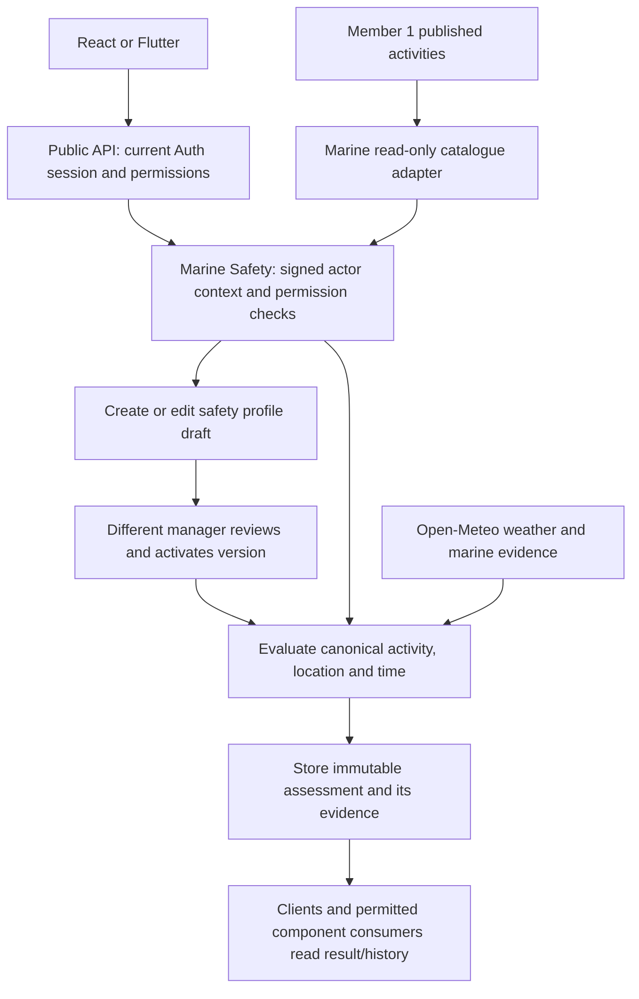

# Marine Safety implementation and component handoff

## What Member 2 owns

Marine Safety answers: **Is this activity suitable at this coastal location
and time, using reviewed limits and the available weather/marine evidence?**

Its managed CRUD resource is the **safety profile**: wind, wave and swell
limits, optional caution limits, and a source/rationale for each factor.
Creating or updating a profile saves an inactive immutable draft. Another
authorized manager reviews and activates it. Deletion deactivates it while
retaining history. Activity CRUD belongs to Member 1. Conditions and assessment
history are read-only; evaluation creates a point-in-time assessment.

Missing/stale required evidence produces `UNKNOWN`. Exceeded hard limits
produce `UNSUITABLE`; explicit caution bands can produce `CAUTION`; otherwise
the result is `SUITABLE`. Unavailable dependencies and unreviewed profiles
block the operation. These are deterministic business rules. Executable
Agentic AI remains gated on G07.

## Implemented producer/consumer contracts

| Boundary | Contract |
|---|---|
| Member 1 → Marine | Private backend `GET /api/experiences/activities`; `{id, code, name, category, status, createdAt, updatedAt}` published activity records; canonical opaque GUID, name ≤100, category ≤100. No activity CRUD is duplicated. |
| API → Marine | `X-Blueverse-Marine-Actor`: signed, 30-second issuer/audience-checked actor and permission context bound to method, path/query and body hash. API uses existing Auth `/api/auth/me`, strips client credentials and replaces untrusted actor headers. |
| Both clients → API | `GET /api/marine/activities` supplies selectors. `GET /api/marine/current` reads conditions independently; `POST /api/marine/evaluate` creates an assessment for a canonical activity ID. Profile CRUD/review and read-only snapshot/assessment history use the endpoint catalog. |
| Marine → planner/operations | Consumers preserve result, assessment/snapshot IDs, source, timestamps, freshness, missing fields and exact reviewed profile evidence. Wind speed is km/h; wave/swell are metres. Consumers never substitute a positive classification for an unavailable/unknown result. |

Configure `EXPERIENCE_CATALOGUE_URL` and deploy Member 1 on the private network.
The adapter returns 503/`Retry-After: 5` on unreachable, timed-out, malformed or
unexpected catalogue responses. No published activities is a valid empty list.
Deleted/unpublished IDs are unavailable for new drafts/edits/reviews/evaluations.
Stored profiles and assessments remain readable. Legacy IDs are never mapped
by label; create and independently review profiles for the canonical IDs.

The [dependency availability contract](../../api/marine-dependency-availability.md)
defines every operation's required data and the structured unavailable fields.
Marine readiness, independent condition lookup, saved evidence and profile
deactivation withstand an absent activity producer. Both clients retain these
capabilities and restore dependent actions after a successful catalogue retry.
Other components should apply the same operation-level isolation within their
own services; this branch does not implement their behavior.

## Integration work still outside this branch

The local remote Member 1 implementation currently requests
`/api/marine/conditions?destinationId=...` and expects a different schema
including `safetyLevel` and wind speed in knots. Those are not Marine's
implemented contract. At integration, its owner must use `/api/marine/current`
for condition evidence or `/api/marine/evaluate` for activity suitability,
consume the actual schema and permissions, and remove any implicit safe
fallback. A backend consumer must use the approved public authorization
boundary or an agreed signed operation-context seam; it cannot send an ordinary
client JWT directly to the private Marine service.

No service is copied from the Member 1 branch here. A live integration run,
PostgreSQL migration execution, physical-device/provider deployment evidence,
component merge and accepted G07 remain separate gates. See
[G00 evidence](../g00/member-2-marine-safety-decisions.md),
[ADR-0021](../../adr/ADR-0021-marine-catalogue-and-gateway-actor-context.md) and
[endpoint catalog](../../api/endpoint-catalog.md).

## Marine Safety input and recovery behavior

React and Flutter expose all three Marine pages with `marine.profile.read`;
profile mutation controls additionally require `marine.profile.manage`. Enter
latitude/longitude as signed decimal WGS84 coordinates. Nonblank invalid filters
are rejected before querying. Maximum and optional caution limits accept at most
two decimal places, preserving the exact reviewed values.

Condition reuse requires matching rounded coordinates, an applicable forecast
from requested time minus 30 minutes through plus one hour, and retrieval within
the preceding 15 minutes. Future retrieval timestamps cannot be reused.
Acquisition/evaluation rejects UTC request times outside
`0001-01-01T01:00:00Z`–`9999-12-31T22:59:59.9999999Z` with 400 before provider
access; provider forecast availability still has its own limits.

Flutter allows 45 seconds per request. An ambiguous timeout or connection failure
after dispatching a write reports that its outcome is unconfirmed and makes no
automatic second attempt. Check assessment history or the profile before retrying;
a timeout does not cancel server work. Read requests may try another configured
gateway candidate. Server-enforced mutation idempotency is not implemented.

## Web entry and shared permission seed integration

Open **Account → Marine & safety**, the sidebar's Marine group or Dashboard's
Marine quick link with `marine.profile.read`; profile writes additionally need
`marine.profile.manage`. Marketing section links belong to Home and are omitted
from Admin. Authorization depends on current grants, not the Admin role name.

Existing member images may have populated the preferred Marine seed GUIDs with
Experiences catalogue codes. Auth now preserves those rows and assignments,
resolves grants by their unique codes and allocates free GUIDs for missing
codes. Rebuild Auth/frontend from this checkout with the existing bootstrap
configuration, then reload the browser. No database reset is required. Local
PostgreSQL verification preserves both existing Experiences permissions/grants
while adding Marine grants; repeated startup is idempotent. Cross-member
consumers must use permission codes, not assume the preferred GUIDs are fixed.
